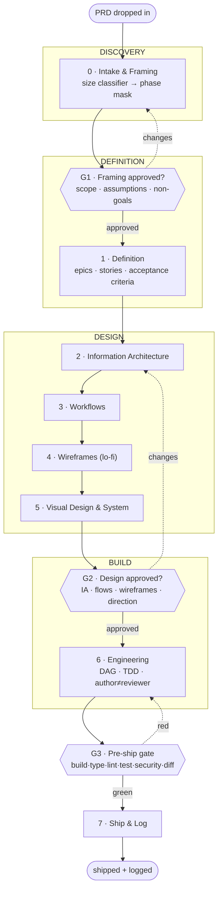

# PRD → Delivery Harness — Process

A committed, reusable **engine**: drop a PRD in, get a structured project out. The harness
plans and creates the folder structure, documents it as real artifacts (Figma, FigJam,
XLSX, DOCX, PDF, PPTX, HTML), and drives the work as a **gated agent pipeline** with the
right specialist called at each stage. One process, run the same way every time.

This file is the contract. It is the source of truth for the stage graph, the gates, the
agent roster, the hand-off protocol, and the artifact-format map. `AGENTS.md` tells an
agent *how to behave*; this file tells it *what the pipeline is*.

## Core idea

Four constants hold on every run:

- **PRD is the source of truth.** Everything downstream traces to a normalized `prd/PRD.md`.
- **Docs are the hand-off.** Each stage writes an artifact plus a HANDOFF verdict naming the
  next stage. The next stage reads files, never conversation memory. State survives
  compaction in a durable ledger.
- **Gates, not autonomy, at the risky seams.** Three human gates bound the run; work flows
  freely between them.
- **Author ≠ reviewer.** Whoever produces an artifact never signs off on it. Review is a
  different agent, ideally a different model.

## The stage graph



Small PRDs skip stages by phase mask (below); large PRDs run all eight. The dashed edges
are the gate rejection loops.

## Gates

| Gate | After | Human confirms | On reject |
| ---- | ----- | -------------- | --------- |
| **G1** | Stage 0 Framing | Scope, the assumptions-to-confirm list, and non-goals are right | Re-frame (loop to 0) |
| **G2** | Stage 5 Visual | IA + flows + wireframes + the chosen visual direction (2–3 offered) | Revise design (loop to 2–5) |
| **G3** | Stage 6 Eng | The verification report is green with **fresh** evidence (the Iron Law: no completion claim without a fresh run) | Fix (loop to 6) |

Between gates, stages hand off automatically. A gate is the only place the pipeline stops
for a human by default.

## Size classifier → phase mask

Stage 0 scores the PRD on three axes and takes the **highest** tier reached on any axis:

- **surface** — how many product areas / screens / services it touches
- **contract-novelty** — new external contracts, data models, or dependencies
- **ambiguity** — how much is assumption vs. stated

| Tier | Phase mask (stages run) | Typical |
| ---- | ----------------------- | ------- |
| `trivial` | 1 → 6 → 7 | copy tweak, one-field change |
| `small` | 1 → (4) → 6 → 7 | one screen, known pattern |
| `standard` | 1 → 2 → 3 → 4 → 6 → 7 | a feature |
| `large` | 0 → 1 → 2 → 3 → 4 → 5 → 6 → 7 | a product / major surface |

Security-sensitive or public-API work is forced to **≥ standard** regardless of score. The
resolved tier, mask, and agent assignments are written to `<project>/.harness/manifest.json`.

## Stages, agents, and deliverables

| # | Stage | Lead agent (+ support) | Deliverable → format |
| - | ----- | ---------------------- | -------------------- |
| 0 | Intake & Framing | `product-analyst` (+ `researcher`, `ux-researcher`) | normalized `prd/PRD.md` · `product-brief` → **DOCX** · **design brief** · **personas** · **ecosystem map** → **Figma/FigJam** · research notes → MD |
| 1 | Definition | `product-manager` (+ `ux-researcher`) | `epics.md` · **`backlog.xlsx`** (epics · stories · AC) · `acceptance-criteria.md` (AC-NNN) · **design principles (DPs)** · **scenarios** |
| 2 | Information Architecture | `ia-architect` | site/app map + entity model → **FigJam** + mermaid |
| 3 | Task Flows | `ux-flows` | journeys + task flows incl. empty/error/edge, walked through the **scenarios** → **FigJam/Figma** + mermaid |
| 4 | Wireframes (lo-fi) | `wireframe-designer` (+ `a11y-reviewer`) | clickable frames → **Figma** + HTML artifacts |
| 5 | Visual Design & System | `visual-designer` (+ `design-system`, `theme-factory` skills, `a11y-reviewer`) | tokens (light+dark) + hi-fi comps → **Figma** + tokens-in-code · brand guide → **PDF** |
| 6 | Engineering | `architect` → `implementer` + `test-author` → `code-reviewer` + `security-reviewer` | code + tests + PRs (TDD, author≠reviewer) |
| 7 | Ship & Log | orchestrator | commit/push · ADRs · changelog · stakeholder deck → **PPTX/PDF** |

Cross-cutting agents: **`council`** (architect + skeptic + pragmatist + critic, fresh
parallel subagents) for any go/no-go decision; **`verifier`** owns the G3 report;
**`a11y-reviewer`** audits every design artefact against WCAG 2.2 AA (author ≠ reviewer).

## UX/UI design artefacts (Figma-drafted)

The design track produces a fixed set of artefacts, each **drafted in Figma / FigJam**
(fallback: HTML artifact or mermaid in-repo when Figma is unavailable), each carrying two
mandatory annotations: a **Rationale** ("why this decision, what was rejected") and an
**Accessibility** note. All Figma/FigJam URLs are recorded in `design/figma-links.md`.

| # | Artefact | Stage | Figma form | In-repo home | Accessibility focus |
| - | -------- | ----- | ---------- | ------------ | ------------------- |
| 1 | **Design brief** | 0 | Figma page / FigJam | `design/brief.md` | audience, constraints, a11y target (WCAG 2.2 AA) stated up front |
| 2 | **Personas** | 0 | FigJam board | `design/personas.md` | include assistive-tech users, low-vision, motor, cognitive load |
| 3 | **Ecosystem map** | 0 | FigJam diagram | `design/ia/ecosystem.md` | surfaces, actors, data + trust boundaries |
| 4 | **Design principles (DPs)** | 1 | Figma page | `design/principles.md` | one principle explicitly names accessibility/inclusion |
| 5 | **Scenarios** | 1 | FigJam / Figma | `design/scenarios.md` | at least one scenario is keyboard-only / screen-reader |
| 6 | **Information architecture** | 2 | FigJam map | `design/ia/` | landmark/heading structure, nav order, focus order |
| 7 | **Task flows** | 3 | FigJam / Figma | `design/flows/` | error/empty/edge states; no colour-only signals |
| 8 | **Wireframes** | 4 | Figma frames | `design/wireframes/` | reading order, target sizes, labels, contrast placeholders |
| 9 | **Visual design + system** | 5 | Figma + tokens | `design/visual/`, `design/design-system/` | contrast ratios, focus states, dark+light parity, motion-reduce |
| 10 | **Rationale log** | 0–5 | annotations + doc | `design/decisions.md` | each design decision: why, alternatives, a11y impact |

**Rationale is not optional.** Every artefact and every non-trivial design decision records a
short rationale (what/why/what-was-rejected) in `design/decisions.md` and inline on the
Figma node. **Accessibility is a first-class acceptance criterion**, not a late audit: the
design brief sets the WCAG 2.2 AA target, each artefact carries its a11y note, `a11y-reviewer`
audits at Stages 4 and 5, and G2 will not pass on an artefact with unresolved a11y blockers.
See `rules/common/accessibility.md`.

## The loop / graph model, precisely

- **Outer graph** — the 8 stages above, linear with the 3 gate loops. Deterministic: a
  given PRD + tier always visits the same stages.
- **Inner refine loop** (per stage) — produce → review → fix, bounded to `N` rounds
  (default 3). At the cap, escalate to a more capable model or invoke `council` as a
  "breaker" to adjudicate rather than looping forever.
- **DAG within Stage 6** — the architect decomposes into `WorkUnit`s (`id`, `deps[]`,
  `acceptance[]`, `tier`); units group into dependency **layers**; a layer runs in parallel
  (isolated worktrees when available), each unit passing through its own
  research→implement→test→review pipeline whose depth scales with the unit's tier. A merge
  queue rebases/tests/lands or evicts-with-conflict-context. The reviewer of a unit is never
  its implementer.
- **Ledger** — `<project>/.harness/ledger/<project>.md` is append-only. Every stage
  transition, gate decision, and refine round is recorded so a fresh agent (post-compaction)
  can resume cold.
- **Memory** — `<project>/memory.md` is the curated *current state* (confirmed facts, key
  decisions, entities, open threads). The ledger says what happened; memory says what is true
  now. Read it first each session; keep it current.
- **Assets** — attached files are ephemeral until ingested into `<project>/assets/` (content-
  hashed, indexed in the manifest) via `assets-intake`. Storage & durability — what survives,
  and where PRDs live — are documented in [`STORAGE.md`](./STORAGE.md).
- **Self-improvement** — friction and gate-rejections can propose harness changes, but only
  behind an explicit `$improve-harness` invocation; never speculative.

## Hand-off protocol

Every stage ends by writing, to the ledger and to its output artifact's frontmatter, a
**HANDOFF** block:

```
HANDOFF
  from: <stage>
  status: ready | needs-decision | blocked
  produced: [<artifact paths>]
  assumptions_to_confirm: [...]     # only if any remain open
  next: <stage or GATE>
```

`ready` advances; `needs-decision` routes to `council` or a gate; `blocked` stops with the
reason. The next stage's first act is to read the prior HANDOFF and the named artifacts —
not the chat.

## Artifact → format map (and honest fallbacks)

| Deliverable | Primary format | Mechanism | Fallback |
| ----------- | -------------- | --------- | -------- |
| PRD, product brief | DOCX / MD | `docx` skill; Drive `create_file` for a Google Doc | MD in repo |
| Research notes | MD | in-repo | — |
| Backlog (epics·stories·AC) | **XLSX** | `xlsx` skill | MD table |
| IA map | **FigJam** | Figma `generate_diagram` / `get_figjam` | mermaid in repo |
| Workflows | **FigJam / Figma** | Figma MCP | mermaid in repo |
| Wireframes | **Figma** | Figma `create_new_file` / `use_figma` | HTML artifacts |
| Design system + hi-fi comps | **Figma** + tokens-in-code | Figma + `design-system` / `theme-factory` | HTML artifacts + tokens |
| Brand guide | PDF | `pdf` skill | MD |
| Stakeholder deck | PPTX / PDF | `pptx` / `pdf` skills | MD |
| Charts / dashboards | HTML / PNG | `dataviz` skill | — |

**Honesty rule:** Google Docs/Sheets are create/read/copy only here (no rich in-doc or
cell editing), so spreadsheets default to local **XLSX** and heavy docs to **DOCX**;
Google versions are offered as a convenience copy, not the source. When a design tool is
unavailable, the stage falls back to mermaid + HTML and the run still completes — the
`figma-links.md` file records whichever coordinates exist.

## What this repo ships (first slice)

`process.md` (this file) · `AGENTS.md` + rules + agent definitions · the `prd-intake`
scaffolder and templates (incl. the `backlog.xlsx` generator) · a worked Stage 0→1 example.
Stages 2–7 are specified here and land as skill bodies stage-by-stage. See `README.md`.
